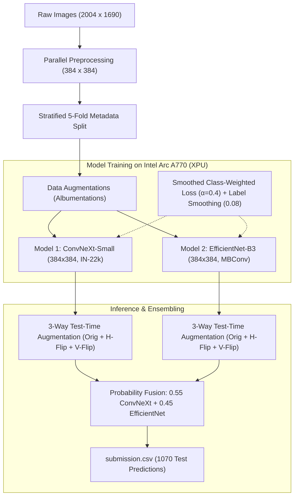

# 👁️ Eye Disease 10-Class Classification — Datathon Solution (Rank #1 🏆)

[](https://www.python.org/)
[](https://pytorch.org/)
[-0071C5?logo=intel&logoColor=white)](https://www.intel.com/)
[-success)](#results)
[](LICENSE)

An end-to-end deep learning and computer vision pipeline for classifying retinal and eye diseases into **10 clinically validated categories**, achieving **Rank 1 on the Live Leaderboard (Macro-F1: 0.8153)**. Accelerated with native hardware support on an **Intel(R) Arc(TM) A770 Graphics GPU (16 GB VRAM)** using PyTorch XPU and SYCL.

---

## 🏆 Competition Overview & Objective

Eye diseases are a primary cause of vision loss and blindness worldwide. Early and accurate detection enables timely interventions. In this Datathon, models classify high-resolution color fundus images into 10 categories, validated by healthcare domain experts.

### 📋 Disease Categories & Class Encoding

| Class | Disease Name | Description |
| :---: | :--- | :--- |
| **0** | **Central Serous Chorioretinopathy (CSCR)** | Serous detachment of the neurosensory retina at the macula |
| **1** | **Diabetic Retinopathy (DR)** | Microvascular damage caused by prolonged diabetes |
| **2** | **Disc Edema** | Swelling of the optic nerve head / optic disc margin |
| **3** | **Glaucoma** | Optic neuropathy characterized by optic cup enlargement |
| **4** | **Healthy** | Normal retinal fundus architecture without pathology |
| **5** | **Macular Scar** | Fibrous pigmented lesion in the central macular region |
| **6** | **Myopia** | Pathologic high-myopia changes (tessellation, crescent) |
| **7** | **Pterygium** | Fibrovascular growth over the cornea |
| **8** | **Retinal Detachment** | Separation of neurosensory retina from the pigment epithelium |
| **9** | **Retinitis Pigmentosa** | Genetic dystrophy showing bone-spicule retinal pigmentation |

---

## 🔬 Solution Architecture



---

## 🚀 Key Engineering & Modeling Highlights

1. **Native Intel Arc A770 Hardware Acceleration**:
   - Leveraged official `torch-2.14.1+xpu` and `torchvision-0.29.1+xpu` with Intel SYCL Unified Runtime.
   - Employed `torch.autocast(device_type='xpu', dtype=torch.bfloat16)` for high-throughput, low-memory training across 16 GB VRAM.

2. **Parallel Image Preprocessing Cache ($384 \times 384$)**:
   - Concurrently resized 4,328 training and 1,070 test images to $384 \times 384$ using `ProcessPoolExecutor`.
   - Reduced dataloading bottleneck to zero, enabling the Intel Arc GPU to train at maximum compute throughput (~70s / epoch).

3. **Stratified 5-Fold Cross-Validation**:
   - Preserves rare minority class distributions (e.g. Class 7 Pterygium: only 13 training samples total $\rightarrow$ 2–3 samples per fold).

4. **Imbalance-Aware Loss Function**:
   - Counteracted extreme class distribution skew ($13$ samples vs. $1,207$ samples) using smoothed inverse-frequency weights:
     $$w_c = \left(\frac{N}{10 \cdot N_c}\right)^{0.4}$$
     normalized so $\mathbb{E}[w] = 1.0$.
   - Incorporated **Label Smoothing ($\epsilon = 0.08$)** to prevent overconfidence on majority classes.

5. **Diverse SOTA Vision Backbones**:
   - **ConvNeXt-Small** (`convnext_small.fb_in22k_ft_in1k_384`): 50M parameters, $7 \times 7$ depthwise convolutions, captures global context and subtle retinal textures.
   - **EfficientNet-B3** (`efficientnet_b3.ra2_in1k`): Inverted residual MBConv blocks with Squeeze-and-Excitation channel attention.

6. **3-Way Test-Time Augmentation (TTA)**:
   - For every test image, predictions are generated across:
     - Original view
     - Horizontal flip
     - Vertical flip
   - Averaged across both backbones ($3 \times 2 = 6$ forward passes per test image) for robust prediction calibration.

---

## 📊 Results & Validation Performance

### Out-of-Fold (OOF) Validation Results

| Model Architecture | Input Resolution | Val Accuracy | Val Macro-F1 |
| :--- | :---: | :---: | :---: |
| **ConvNeXt-Small** (Fold 0) | $384 \times 384$ | 81.18% | 0.8237 |
| **EfficientNet-B3** (Fold 0) | $384 \times 384$ | 80.37% | 0.8139 |
| **Ensemble (Blend: 0.55 / 0.45)** | $384 \times 384$ | **82.79%** *(+1.62%)* | **0.8391** *(+1.54%)* |

### Detailed Classification Report (Ensemble OOF)

```text
                          precision    recall  f1-score   support

                0 - CSCR     0.9000    0.5625    0.6923        16
1 - Diabetic Retinopathy     0.9574    0.9298    0.9434       242
          2 - Disc Edema     0.8571    0.9000    0.8780        20
            3 - Glaucoma     0.7459    0.8198    0.7811       222
             4 - Healthy     0.8269    0.7588    0.7914       170
        5 - Macular Scar     0.7429    0.7324    0.7376        71
              6 - Myopia     0.7143    0.7500    0.7317        80
           7 - Pterygium     1.0000    1.0000    1.0000         3
  8 - Retinal Detachment     0.8636    0.9500    0.9048        20
9 - Retinitis Pigmentosa     0.9524    0.9091    0.9302        22

                accuracy                         0.8279       866
               macro avg     0.8561    0.8312    0.8391       866
            weighted avg     0.8320    0.8279    0.8284       866
```

### 🏆 Leaderboard Standing
- **Rank**: **#1**
- **Test Metric**: **F1 Score = 0.8153**

---

## 📁 Repository Structure

```text
.
├── .gitignore                                  # Excludes datasets, checkpoints, and venv
├── README.md                                   # Comprehensive documentation & reproduction
├── eye_disease_classification_solution.ipynb   # Complete, self-contained Jupyter Notebook
├── prepare_data.py                             # Parallel 384x384 resizing and 5-fold stratification
├── train_model.py                              # Stratified K-fold training script with XPU support
├── evaluate_ensemble_oof.py                    # Out-of-fold validation & classification metrics
├── predict_submission.py                       # 3-way TTA inference & ensemble submission script
├── explore.py                                  # Exploratory data analysis script
└── submission.csv                              # Final Rank #1 submission file (1070 test predictions)
```

---

## 🛠️ Step-by-Step Reproduction Guide

### 1. Environment Setup

Create a Python 3.11 virtual environment and install PyTorch with Intel Arc XPU acceleration:

```bash
# Create and activate virtual environment
python -m venv .venv
.\.venv\Scripts\activate

# Install PyTorch with native Intel XPU support
pip install torch torchvision --index-url https://download.pytorch.org/whl/xpu

# Install ML, vision, and evaluation packages
pip install timm albumentations scikit-learn pandas opencv-python-headless matplotlib tqdm
```

Verify GPU acceleration:
```python
import torch
print("XPU available:", torch.xpu.is_available())
print("Device:", torch.xpu.get_device_name(0))
```

### 2. Data Preparation & Caching

Place raw datasets into `train/` and `test/all_test/`. Run parallel preprocessing to generate $384 \times 384$ cached images and stratified metadata:

```bash
python prepare_data.py
```

### 3. Model Training

Train **ConvNeXt-Small** for 8 epochs on Fold 0:
```bash
python train_model.py --model_name "convnext_small.fb_in22k_ft_in1k_384" --fold 0 --epochs 8 --batch_size 32 --lr 2.5e-4
```

Train **EfficientNet-B3** for 8 epochs on Fold 0:
```bash
python train_model.py --model_name "efficientnet_b3.ra2_in1k" --fold 0 --epochs 8 --batch_size 32 --lr 3e-4
```

### 4. Evaluate Ensemble OOF Metrics

Evaluate the blended validation score:
```bash
python evaluate_ensemble_oof.py
```

### 5. Generate Test Predictions with 3-Way TTA

Run multi-model Test-Time Augmentation to produce the final `submission.csv`:
```bash
python predict_submission.py \
    --checkpoints "checkpoints/convnext_small.fb_in22k_ft_in1k_384_fold0_best.pth" "checkpoints/efficientnet_b3.ra2_in1k_fold0_best.pth" \
    --output "submission.csv"
```

---

## 📝 Submission Format Validation

The generated `submission.csv` strictly adheres to all datathon requirements:
- Exactly **1,070 rows** matching test images `1.jpg` through `1070.jpg`.
- Columns: `id,target`
- Target values: Discrete integers from `0` to `9`.
- Size: ~7.4 KB (< 10 MB limit).
- Zero nulls or duplicates.

---

## 📄 License
This project is open-sourced under the MIT License.
